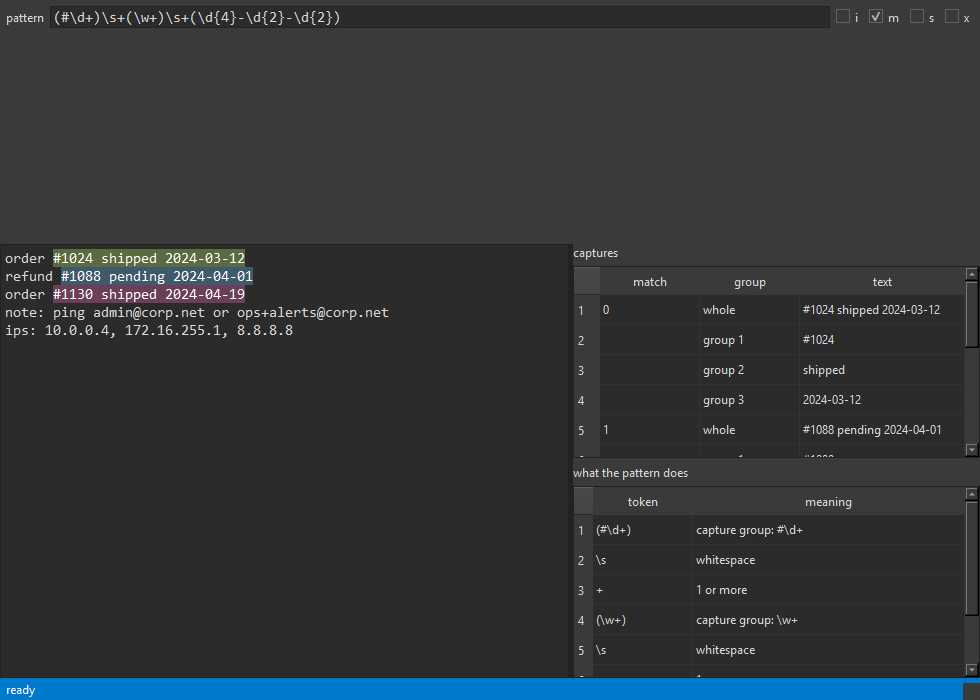

# regexer

a live regex tester - type a pattern, matches light up in the sample
text, groups get listed, and a little table explains what each token in
the pattern actually does.

basically a local regex101 because i got tired of opening the website.

## run it

```
py -3.14 -m pip install PySide6
py -3.14 regexer.py
```

## what it looks like



## stuff it does

- live matching while you type - every match gets its own color
- captures table: match #, group #, and the captured text for each group
- token explainer: breaks the pattern into `\d`, `(`, `+`, `[...]` etc
  and says what each piece means
- flags: i (ignorecase), m (multiline), s (dotall), x (verbose)
- bad patterns show the real python error under the input, nothing
  silently breaks

## how it works

- `re` does the matching, `QSyntaxHighlighter` paints the match ranges
  per color
- a re-entrancy guard stops the document-change signal from looping
  back into the refresh (learned that the hard way)
- the explainer is a little scanner that walks the pattern with a token
  table - not a full regex parser, but honest
